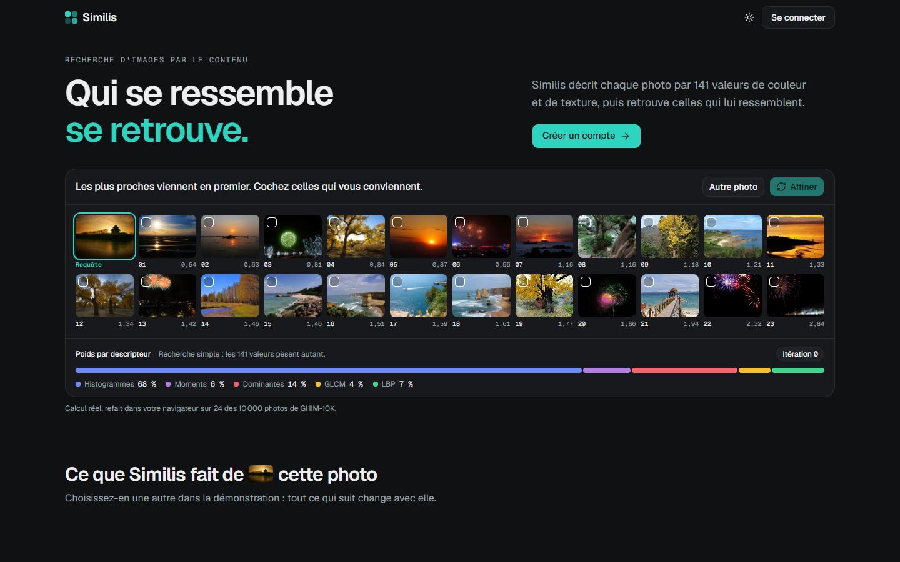
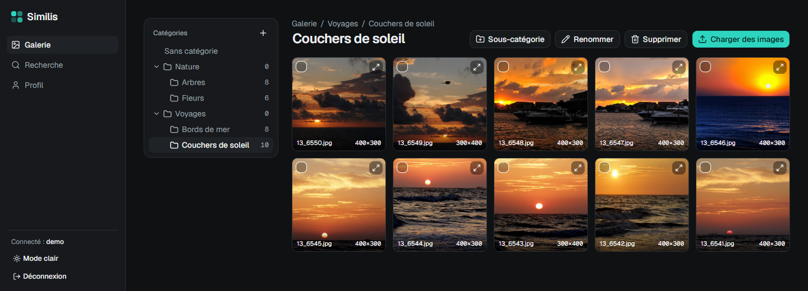
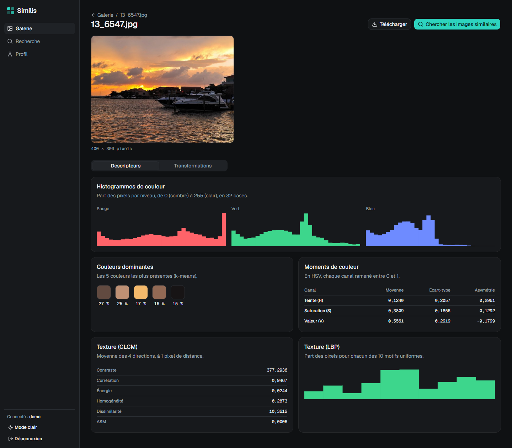
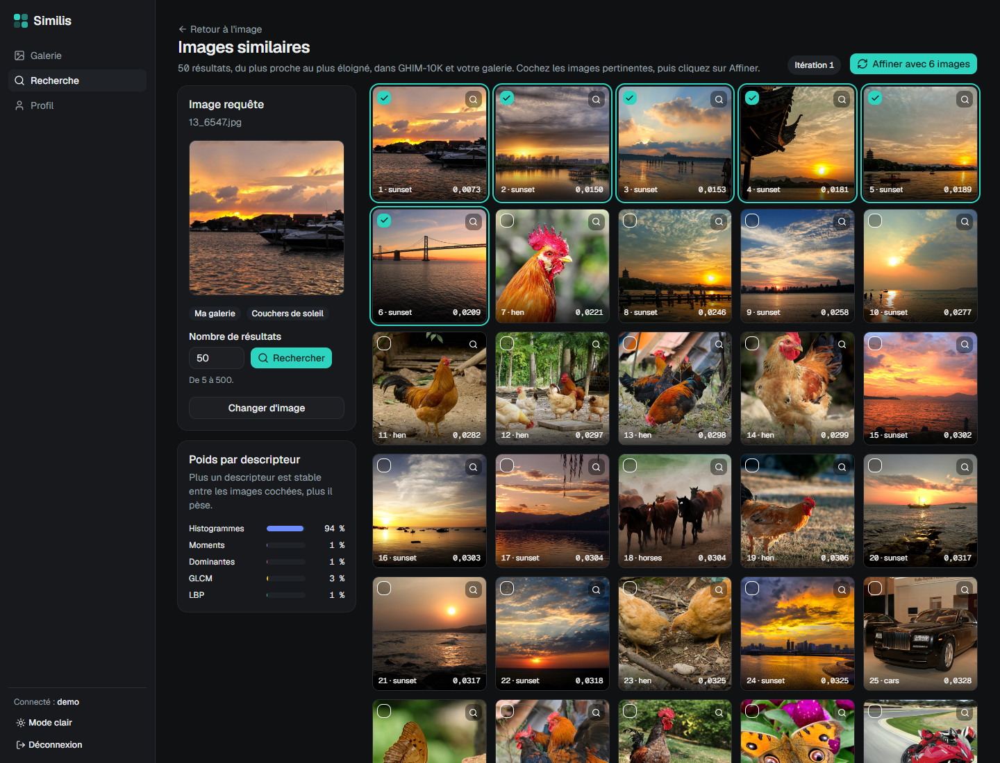

# Similis

[English](README.md) | Français



Similis est une galerie de photos avec recherche d'images par le contenu (CBIR). On charge ses photos et on les range dans des catégories imbriquées. Chaque photo est décrite par un vecteur de 141 valeurs de couleur et de texture. On cherche ensuite les images similaires dans sa galerie et dans la base GHIM-10K, puis on affine le résultat par retour de pertinence **Feature Relevance Estimation (FRE)**.

Mini-projet 1 du module Multimedia Mining (groupe 1). L'interface est en français.

## Fonctionnalités

- **Comptes** : inscription, connexion, déconnexion. Chaque utilisateur ne voit que ses images.
- **Galerie** : charger une ou plusieurs images JPG/PNG, télécharger une image (ou plusieurs dans un ZIP), supprimer, déplacer entre catégories et sous-catégories.
- **Transformations** : recadrage (à la souris), échelle, rotation, miroir, niveaux de gris. Chacune crée une nouvelle image et garde l'originale.
- **Descripteurs**, calculés par une API Flask-RESTful pour une image ou une liste d'images :

  | Famille | Descripteur | Valeurs |
  |---|---|---|
  | Couleur | Histogrammes R, G, B, 32 cases chacun | 96 |
  | Couleur | Moyenne, écart-type, asymétrie de H, S, V | 9 |
  | Couleur | 5 couleurs dominantes (k-means), RVB + proportion | 20 |
  | Texture | GLCM : contraste, corrélation, énergie, homogénéité, dissimilarité, ASM | 6 |
  | Texture | LBP uniforme (8 voisins, rayon 1) | 10 |

- **Recherche simple** : la requête est une image de la galerie ou de GHIM-10K. Chaque composante est centrée-réduite avec les statistiques de GHIM-10K, puis les images sont classées par distance quadratique moyenne.
- **Retour de pertinence FRE** : on coche les résultats pertinents, puis on clique sur « Affiner ».
  - La nouvelle requête est la moyenne de l'ensemble pertinent (la requête et toutes les images cochées depuis le début).
  - Chaque composante reçoit le poids `w = 1 / (ε + σ)`, avec ε = 0,0001.
  - La distance pondérée est `Σ w (x − y)² / Σ w`.
  - L'écran affiche le numéro d'itération et la part du poids total de chaque descripteur.
- **Page d'accueil publique** avec une démonstration en direct : recherche simple et FRE refaites dans le navigateur sur 24 images de GHIM-10K.
- **Documentation Swagger** de l'API sur `http://localhost:5000/apidocs`.

## Captures d'écran

**Galerie** : catégories imbriquées, chargement, actions sur plusieurs images cochées.



**Page d'une image** : ses 5 descripteurs (histogrammes RVB, couleurs dominantes, moments HSV, GLCM, LBP). L'onglet Transformations est à côté.



**Recherche après une itération FRE** : 6 couchers de soleil ont été cochés. Les histogrammes portent maintenant 94 % du poids total, et les images pertinentes remontent en tête.



## Précision mesurée

`backend/evaluer.py` simule le retour de pertinence sur GHIM-10K. Il lance 100 requêtes (5 par catégorie, graine fixe) et garde les 25 premiers résultats. Une image est pertinente si elle est dans la même catégorie que la requête ; la requête elle-même n'est pas comptée.

| Itération | 1 (simple) | 2 | 3 | 4 | 5 | 6 | 7 |
|---|---|---|---|---|---|---|---|
| Précision moyenne | 0,3108 | 0,4436 | 0,4804 | 0,4888 | 0,4920 | 0,4960 | 0,4956 |

## Technologies

| Partie | Technologie |
|---|---|
| Backend | Python 3.13, Flask 3.1, Flask-RESTful, flasgger, SQLite |
| Traitement d'images | OpenCV, NumPy, scikit-image |
| Frontend | Vue 3, Vue Router, Vite, Tailwind CSS 4, shadcn-vue, Motion, Chart.js |

Testé avec Python 3.13.5 et Node 22.17.0 sous Windows 11.

## Installation

Prérequis : Python 3.13 et Node 22.

```bash
python -m venv .venv
.venv\Scripts\python.exe -m pip install -r backend\requirements.txt
npm install --prefix frontend
```

Sous Linux ou macOS, remplacer `.venv\Scripts\python.exe` par `.venv/bin/python`.

### Base d'images

Télécharger GHIM-10K et l'extraire pour que les images soient dans `data/GHIM-10K/<catégorie>/*.jpg`. La base compte 20 dossiers de 500 images. L'application ne fait que lire ce dossier.

### Indexation

Calculer une fois les descripteurs des 10 000 images de GHIM-10K. Cela prend environ 10 minutes sur un cœur :

```bash
.venv\Scripts\python.exe backend\indexer.py
```

Pour un essai rapide, indexer seulement les N premières images, par exemple `backend\indexer.py 100`. L'index est écrit dans `storage/index/ghim.npz`. Le relancer si `backend/descripteurs.py` change. Sans index, les services de recherche répondent 503.

### Évaluation (facultative)

```bash
.venv\Scripts\python.exe backend\evaluer.py
```

Cela prend environ 5 secondes. Le script affiche la précision des 7 itérations et écrit `storage/evaluation.csv`, que la page d'accueil affiche.

## Lancement

Lancer le backend (port 5000) et le frontend (port 5173) dans deux terminaux :

```bash
.venv\Scripts\python.exe backend\app.py
```

```bash
npm run dev --prefix frontend
```

Ouvrir `http://localhost:5173`. Vite redirige `/api` vers Flask : le cookie de session fonctionne sans CORS.

## Vérifications

Chaque module de calcul a une petite vérification exécutable :

```bash
.venv\Scripts\python.exe backend\test_descripteurs.py
```

Les autres sont `test_auth.py`, `test_galerie.py`, `test_transformations.py`, `test_indexer.py`, `test_recherche.py`, `test_affiner.py`, `test_evaluer.py` et `test_vitrine.py`, dans `backend/`. Elles travaillent dans des dossiers temporaires. Le calcul FRE fait dans le navigateur a sa propre vérification :

```bash
node frontend/test_fre.mjs
```

## Organisation du projet

```
backend/
  app.py              crée l'application Flask et déclare les routes
  openapi.yaml        description de l'API affichée par Swagger
  auth.py             comptes et contrôle de session
  categories.py       arbre des catégories
  images.py           chargement, téléchargement, suppression, service des descripteurs
  transformations.py  les 5 transformations
  descripteurs.py     le vecteur de 141 valeurs (sans dépendance à Flask)
  recherche.py        index GHIM-10K en mémoire, recherche simple, FRE, vitrine de l'accueil
  indexer.py          indexe GHIM-10K
  evaluer.py          mesure la précision avec un retour simulé
frontend/src/
  api.js              tous les appels au backend
  fre.js              recherche et FRE dans le navigateur, pour la démonstration de l'accueil
  vues/               pages : accueil, connexion, galerie, image, recherche, profil
  composants/         petits composants partagés
paper/                papier de référence sur les stratégies de repondération
screenshots/          captures d'écran de ce README
```

Les données générées restent hors du dépôt. `data/` contient la base téléchargée. `storage/` contient tout ce que l'application écrit : la base SQLite, les images chargées, l'index, le tableau d'évaluation et la clé de session.

## Référence

Les formules FRE suivent le papier de `paper/`, *Reweighing Strategies for Relevance Feedback in CBIR* : formules (1), (3), (4) et tableau 1.
