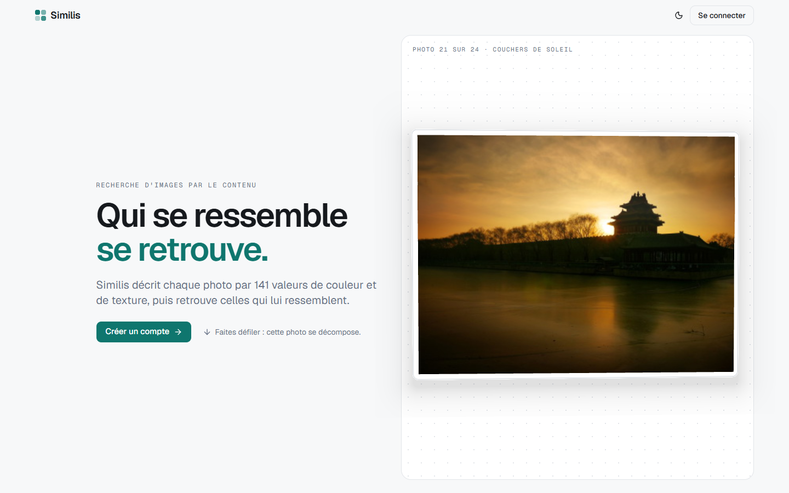

# Similis



Similis est une galerie de photos avec une recherche d'images par le contenu (CBIR). On envoie ses photos et on les range dans des catégories, qui peuvent contenir des sous-catégories. Chaque photo est décrite par un vecteur de 141 valeurs, calculé à partir de ses couleurs et de sa texture. On peut ensuite chercher les images qui lui ressemblent, dans sa galerie et dans la base GHIM-10K, puis affiner les résultats avec un retour de pertinence.

**Démo en ligne** : https://similis.onrender.com. Le serveur se met en veille après 15 minutes sans visite : la première page peut alors mettre environ une minute à s'afficher.

## Équipe

Nous sommes le **groupe 1**. La technique de retour de pertinence qui nous a été attribuée est la **Feature Relevance Estimation (FRE)**.

Réalisé par :

- El Attari Taki Eddine
- Belkasmi Abderrahmane
- Eddiaz Louai

Encadré par : M. Ait Kbir

## Fonctionnalités

- **Comptes** : inscription, connexion, déconnexion. Chaque utilisateur ne voit que ses propres images.
- **Galerie** : envoyer une ou plusieurs images JPG/PNG, en télécharger une (ou plusieurs dans un ZIP), les supprimer, et les déplacer entre catégories et sous-catégories.
- **Transformations** : recadrer (à la souris), redimensionner, pivoter, faire un miroir, passer en niveaux de gris. Chaque transformation crée une nouvelle image et garde l'originale.
- **Descripteurs**, calculés par une API Flask-RESTful pour une image ou une liste d'images :

  | Famille | Descripteur | Valeurs |
  |---|---|---|
  | Couleur | Histogrammes R, G, B, 32 cases chacun | 96 |
  | Couleur | Moyenne, écart-type et asymétrie de H, S, V | 9 |
  | Couleur | 5 couleurs dominantes (k-means), RGB + part | 20 |
  | Texture | GLCM : contraste, corrélation, énergie, homogénéité, dissimilarité, ASM | 6 |
  | Texture | LBP uniforme (8 voisins, rayon 1) | 10 |

- **Recherche simple** : la requête est une image de la galerie ou de GHIM-10K. Chaque valeur est normalisée (z-score) avec les statistiques de GHIM-10K, puis les images sont classées par distance quadratique moyenne.
- **Retour de pertinence FRE** : on coche les résultats pertinents, puis on clique sur « Affiner ».
  - La nouvelle requête est la moyenne des images pertinentes (la requête et toutes les images cochées jusqu'ici).
  - Chaque valeur reçoit le poids `w = 1 / (ε + σ)`, avec ε = 0,0001.
  - La distance pondérée vaut `Σ w (x − y)² / Σ w`.
  - L'écran affiche le numéro de l'itération et la part du poids total de chaque descripteur.
- **Page d'accueil publique** avec une démonstration. Elle fait la recherche simple et FRE directement dans le navigateur, sur 24 images de GHIM-10K.
- **Documentation Swagger** de l'API sur `http://localhost:5000/apidocs`.

## Captures d'écran

**Galerie** : catégories imbriquées, envoi d'images, actions sur plusieurs images à la fois.


**Page d'une image** : ses 5 descripteurs (histogrammes RGB, couleurs dominantes, moments HSV, GLCM, LBP). L'onglet Transformations est juste à côté.


**Recherche après une itération FRE** : 6 couchers de soleil ont été marqués pertinents. Les histogrammes portent maintenant 90 % du poids total, et les images pertinentes remontent en tête.


## Précision mesurée

`backend/evaluer.py` simule le retour de pertinence sur GHIM-10K. Il lance 100 requêtes (5 par catégorie, tirées avec une graine fixe) et garde les 25 premiers résultats. Une image est jugée pertinente si elle est de la même catégorie que la requête. La requête elle-même n'est pas comptée.

| Itération | 1 (simple) | 2 | 3 | 4 | 5 | 6 | 7 |
|---|---|---|---|---|---|---|---|
| Précision moyenne | 0,3108 | 0,4436 | 0,4804 | 0,4888 | 0,4920 | 0,4960 | 0,4956 |

## Technologies

| Partie | Technologies |
|---|---|
| Backend | Python 3.13, Flask 3.1, Flask-RESTful, flasgger, SQLite |
| Traitement d'images | OpenCV, NumPy, scikit-image |
| Frontend | Vue 3, Vue Router, Vite, Tailwind CSS 4, shadcn-vue, Motion, Chart.js |

Testé avec Python 3.13.5 et Node 22.17.0 sous Windows 11.

## Installation

Il faut avoir Git, Python 3.13 et Node 22.

```bash
git clone https://github.com/Taki-eddine-El-Attari/Similis.git
cd Similis
python -m venv .venv
.venv\Scripts\python.exe -m pip install -r backend\requirements.txt
npm ci --prefix frontend
```

Les commandes de ce README sont écrites pour Windows. Sous Linux ou macOS, remplacez `.venv\Scripts\python.exe` par `.venv/bin/python`, et `\` par `/` dans les chemins.

Utilisez bien `npm ci` et pas `npm install` : avec npm 10, `npm install --prefix frontend` cherche un `package.json` à la racine du dépôt et échoue.

### Base d'images

GHIM-10K se télécharge sur Kaggle : https://www.kaggle.com/datasets/guohey/ghim10k (un zip de 1,2 Go, il faut un compte Kaggle gratuit). Décompressez-la pour que les images soient dans `data/GHIM-10K/<catégorie>/*.jpg` :

```
data/GHIM-10K/aircraft/10_5001.jpg
data/GHIM-10K/dragon fly/...
...
```

Il doit y avoir exactement 20 dossiers de 500 images directement dans `data/GHIM-10K/`. Si le zip ajoute un dossier parent en plus, remontez les 20 dossiers d'un niveau. Ne renommez pas les dossiers : deux d'entre eux contiennent un espace (`dragon fly`, `sea shores`). L'application ne fait que lire ce dossier.

### Indexation

Calculez une seule fois les descripteurs des 10 000 images de GHIM-10K. Ça prend environ 10 minutes sur un cœur :

```bash
.venv\Scripts\python.exe backend\indexer.py
```

Pour un essai rapide, on peut n'indexer que les N premières images, par exemple `backend\indexer.py 100`. Attention : ces premières images sont toutes de la même catégorie (aircraft). Toutes les recherches renvoient donc des avions, et l'évaluation affiche un 1,0000 qui ne veut rien dire. Pour de vrais résultats, indexez les 10 000 images.

L'index est écrit dans `storage/index/ghim.npz`. Il faut le refaire si `backend/descripteurs.py` change. Sans index, les services de recherche répondent 503.

### Évaluation (facultatif)

```bash
.venv\Scripts\python.exe backend\evaluer.py
```

Ça prend environ 5 secondes. Le script affiche la précision des 7 itérations et écrit `storage/evaluation.csv`, que la page d'accueil affiche.

## Lancement

Lancez le backend (port 5000) et le frontend (port 5173) dans deux terminaux :

```bash
.venv\Scripts\python.exe backend\app.py
```

```bash
npm run dev --prefix frontend
```

Ouvrez `http://localhost:5173`. Vite redirige `/api` vers Flask : le cookie de session marche donc sans CORS.

La page d'accueil marche sans compte. Pour la galerie et la recherche, créez d'abord un compte avec le bouton « Créer un compte » de la page d'accueil (ou l'onglet « Inscription » de la page de connexion).

### Avec un seul serveur

Pour tout faire tourner sur le port 5000, compilez le frontend une fois. Flask sert alors les fichiers compilés à côté de l'API :

```bash
npm run build --prefix frontend
.venv\Scripts\python.exe backend\app.py
```

Ouvrez `http://localhost:5000`. Il faut recompiler après chaque modification du frontend.

### Docker

Le `Dockerfile` à la racine compile le frontend, installe le backend avec gunicorn et sert le tout sur le port `$PORT` (10000 par défaut). C'est l'image utilisée pour la démo en ligne sur Render. Elle n'utilise pas votre dossier `data/` local : pendant la construction, elle télécharge une archive qui contient `data/GHIM-10K/`, `storage/index/ghim.npz` et `storage/evaluation.csv`. L'adresse de l'archive est donnée par l'argument `DONNEES`, et le jeton d'accès par le secret `HF_TOKEN`.

## Vérifications

Chaque module de calcul a son petit script de vérification :

```bash
.venv\Scripts\python.exe backend\test_descripteurs.py
```

Les autres sont `test_auth.py`, `test_galerie.py`, `test_transformations.py`, `test_indexer.py`, `test_recherche.py`, `test_affiner.py`, `test_evaluer.py` et `test_vitrine.py`, dans `backend/`. Ils travaillent dans des dossiers temporaires. Le calcul FRE fait dans le navigateur a aussi sa vérification :

```bash
node frontend/test_fre.mjs
```

## Organisation du projet

```
backend/
  app.py              crée l'application Flask et déclare les routes
  openapi.yaml        description de l'API affichée par Swagger
  auth.py             comptes et contrôle de la session
  categories.py       arbre des catégories
  images.py           envoi, téléchargement, suppression, service des descripteurs
  transformations.py  les 5 transformations
  descripteurs.py     le descripteur de 141 valeurs (sans Flask)
  recherche.py        index de GHIM-10K en mémoire, recherche simple, FRE, vitrine de l'accueil
  indexer.py          indexe GHIM-10K
  evaluer.py          mesure la précision avec un retour de pertinence simulé
frontend/src/
  api.js              tous les appels au backend
  fre.js              recherche et FRE dans le navigateur, pour la démo de l'accueil
  vues/               pages : accueil, connexion, galerie, image, recherche, profil
  composants/         petits composants partagés
screenshots/          captures d'écran de ce README
```

Les données générées ne sont pas dans le dépôt. `data/` contient la base téléchargée. `storage/` contient tout ce que l'application écrit : la base SQLite, les images envoyées, l'index, le tableau d'évaluation et la clé de session.

## Référence

Les formules FRE suivent les formules (1), (3), (4) et le tableau 1 de cet article :

Renuka Devi SM, « Reweighing Strategies for Relevance Feedback in CBIR », *International Journal of Advanced Research in Computer and Communication Engineering (IJARCCE)*, vol. 5, n° 11, novembre 2016, p. 549-555. DOI indiqué sur l'article : 10.17148/IJARCCE.2016.511118.

## Licence

Copyright (C) 2026 El Attari Taki Eddine, Belkasmi Abderrahmane, Eddiaz Louai.

Le code de Similis est sous licence **GNU GPL v3** (voir le fichier `LICENSE`). Vous pouvez l'utiliser, le modifier et le redistribuer, à condition que tout projet qui reprend ce code soit lui aussi publié sous GPL v3, avec son code source.

La licence ne couvre que notre code. L'article de référence et les images de GHIM-10K restent la propriété de leurs auteurs.
