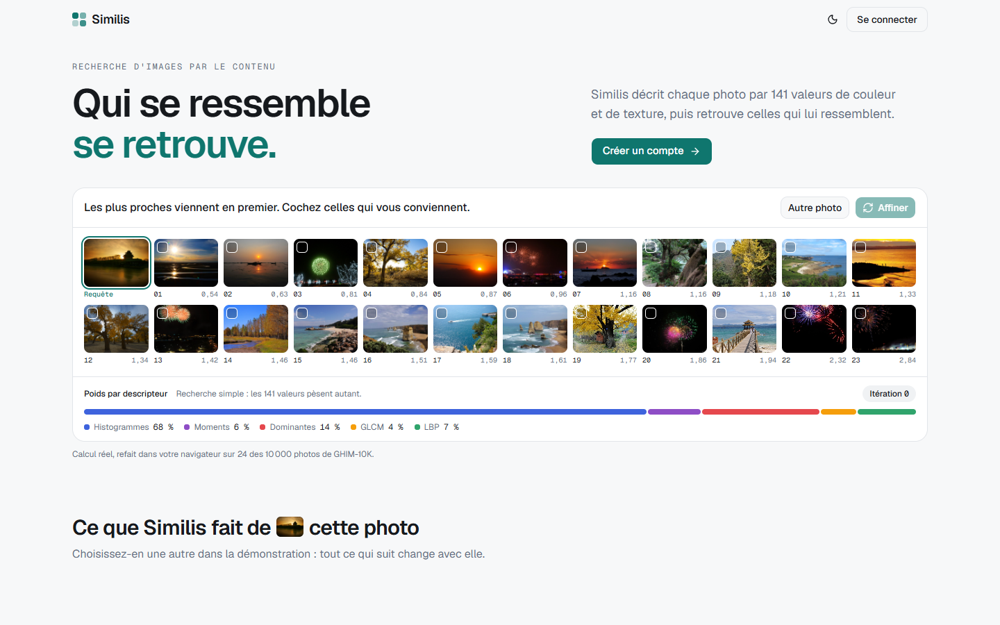
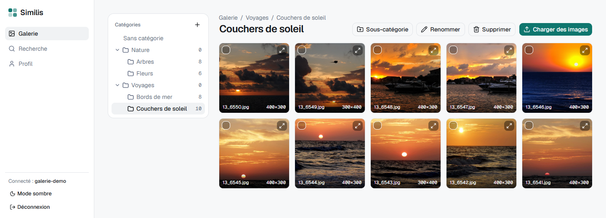
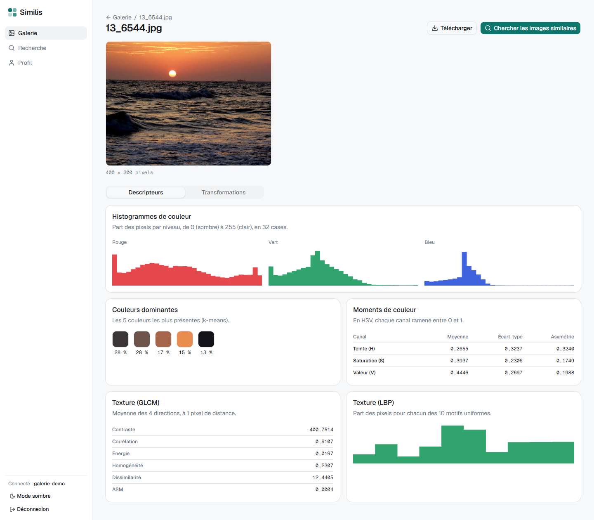
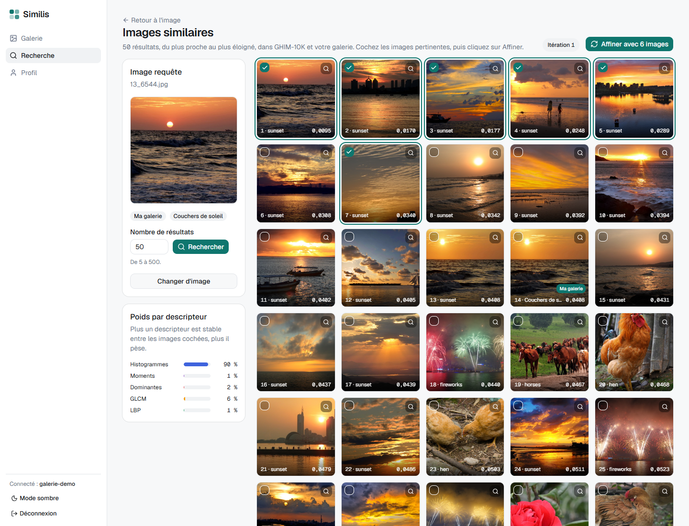

# Similis



Similis is a photo gallery with content-based image retrieval (CBIR). You upload photos and sort them into nested categories. Each photo is described by a 141-value color and texture vector. You then search for similar images across your gallery and the GHIM-10K dataset, and refine the results with **Feature Relevance Estimation (FRE)** relevance feedback.

This is mini-project 1 of the Multimedia Mining course (group 1). The user interface is in French.

## Features

- **Accounts**: sign up, sign in, sign out. Each user only sees their own images.
- **Gallery**: upload one or several JPG/PNG images, download one (or several as a ZIP), delete, and move images between categories and sub-categories.
- **Transformations**: crop (with the mouse), scale, rotate, mirror, grayscale. Each one creates a new image and keeps the original.
- **Descriptors**, computed by a Flask-RESTful API for one image or a list of images:

  | Family | Descriptor | Values |
  |---|---|---|
  | Color | R, G, B histograms, 32 bins each | 96 |
  | Color | Mean, standard deviation, skewness of H, S, V | 9 |
  | Color | 5 dominant colors (k-means), RGB + share | 20 |
  | Texture | GLCM: contrast, correlation, energy, homogeneity, dissimilarity, ASM | 6 |
  | Texture | Uniform LBP (8 neighbors, radius 1) | 10 |

- **Simple search**: the query is a gallery image or a GHIM-10K image. Each component is z-normalized with GHIM-10K statistics, and images are ranked by mean squared distance.
- **FRE relevance feedback**: tick the relevant results, then click "Affiner".
  - The new query is the mean of the relevant set (the query and every image ticked so far).
  - Each component gets the weight `w = 1 / (ε + σ)`, with ε = 0.0001.
  - The weighted distance is `Σ w (x − y)² / Σ w`.
  - The screen shows the iteration number and each descriptor's share of the total weight.
- **Public landing page** with a live demo. It runs simple search and FRE in the browser on 24 GHIM-10K images.
- **Swagger** documentation of the API at `http://localhost:5000/apidocs`.

## Screenshots

**Gallery**: nested categories, upload, multi-select actions.



**Image page**: the 5 descriptors of one image (RGB histograms, dominant colors, HSV moments, GLCM, LBP). The Transformations tab is next to it.



**Search after one FRE iteration**: 6 sunsets were marked relevant. The histograms now carry 90 % of the total weight, and the relevant images move to the top.



## Measured precision

`backend/evaluer.py` simulates relevance feedback on GHIM-10K. It runs 100 queries (5 per category, fixed seed) and keeps the top 25 results. An image counts as relevant when it shares the query's category, and the query itself is not counted.

| Iteration | 1 (simple) | 2 | 3 | 4 | 5 | 6 | 7 |
|---|---|---|---|---|---|---|---|
| Mean precision | 0.3108 | 0.4436 | 0.4804 | 0.4888 | 0.4920 | 0.4960 | 0.4956 |

## Stack

| Part | Technology |
|---|---|
| Backend | Python 3.13, Flask 3.1, Flask-RESTful, flasgger, SQLite |
| Image processing | OpenCV, NumPy, scikit-image |
| Frontend | Vue 3, Vue Router, Vite, Tailwind CSS 4, shadcn-vue, Motion, Chart.js |

Tested with Python 3.13.5 and Node 22.17.0 on Windows 11.

## Installation

Requirements: Python 3.13 and Node 22.

```bash
python -m venv .venv
.venv\Scripts\python.exe -m pip install -r backend\requirements.txt
npm install --prefix frontend
```

On Linux or macOS, use `.venv/bin/python` instead of `.venv\Scripts\python.exe`.

### Dataset

Download GHIM-10K and extract it so that the images are in `data/GHIM-10K/<category>/*.jpg`. The dataset has 20 folders of 500 images. The application only reads this folder.

### Indexing

Compute the descriptors of the 10,000 GHIM-10K images once. This takes about 10 minutes on one core:

```bash
.venv\Scripts\python.exe backend\indexer.py
```

For a quick test, index only the first N images, for example `backend\indexer.py 100`. The index is written to `storage/index/ghim.npz`. Run it again if `backend/descripteurs.py` changes. Without an index, the search services answer 503.

### Evaluation (optional)

```bash
.venv\Scripts\python.exe backend\evaluer.py
```

This takes about 5 seconds. It prints the precision of the 7 iterations and writes `storage/evaluation.csv`, which the landing page displays.

## Running

Start the backend (port 5000) and the frontend (port 5173) in two terminals:

```bash
.venv\Scripts\python.exe backend\app.py
```

```bash
npm run dev --prefix frontend
```

Open `http://localhost:5173`. Vite forwards `/api` to Flask, so the session cookie works without CORS.

## Checks

Each computation module has a small runnable check:

```bash
.venv\Scripts\python.exe backend\test_descripteurs.py
```

The other checks are `test_auth.py`, `test_galerie.py`, `test_transformations.py`, `test_indexer.py`, `test_recherche.py`, `test_affiner.py`, `test_evaluer.py` and `test_vitrine.py` in `backend/`. They work on temporary folders. The in-browser FRE code has its own check:

```bash
node frontend/test_fre.mjs
```

## Project layout

```
backend/
  app.py              creates the Flask app and declares the routes
  openapi.yaml        API description shown by Swagger
  auth.py             accounts and the session check
  categories.py       category tree
  images.py           upload, download, delete, descriptors service
  transformations.py  the 5 transformations
  descripteurs.py     the 141-value descriptor (no Flask dependency)
  recherche.py        GHIM-10K index in memory, simple search, FRE, landing page showcase
  indexer.py          indexes GHIM-10K
  evaluer.py          measures precision with simulated feedback
frontend/src/
  api.js              every call to the backend
  fre.js              search and FRE in the browser, for the landing page demo
  vues/               pages: landing, sign in, gallery, image, search, profile
  composants/         small shared components
paper/                reference paper on reweighting strategies for relevance feedback
screenshots/          screenshots used in this README
```

Generated data stays out of the repository. `data/` holds the downloaded dataset. `storage/` holds everything the application writes: the SQLite database, uploaded images, the index, the evaluation table and the session key.

## Reference

The FRE formulas follow the paper in `paper/`, *Reweighing Strategies for Relevance Feedback in CBIR*: formulas (1), (3), (4) and Table 1.
